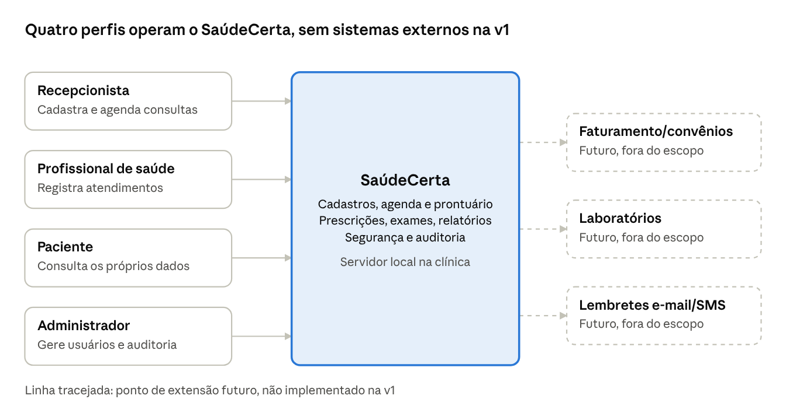
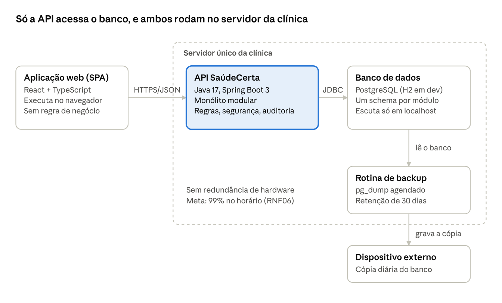
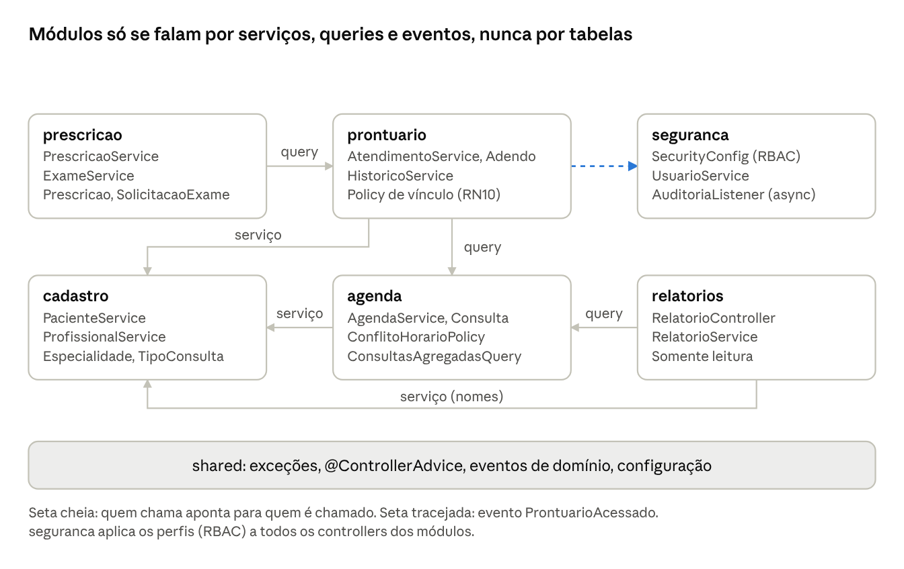
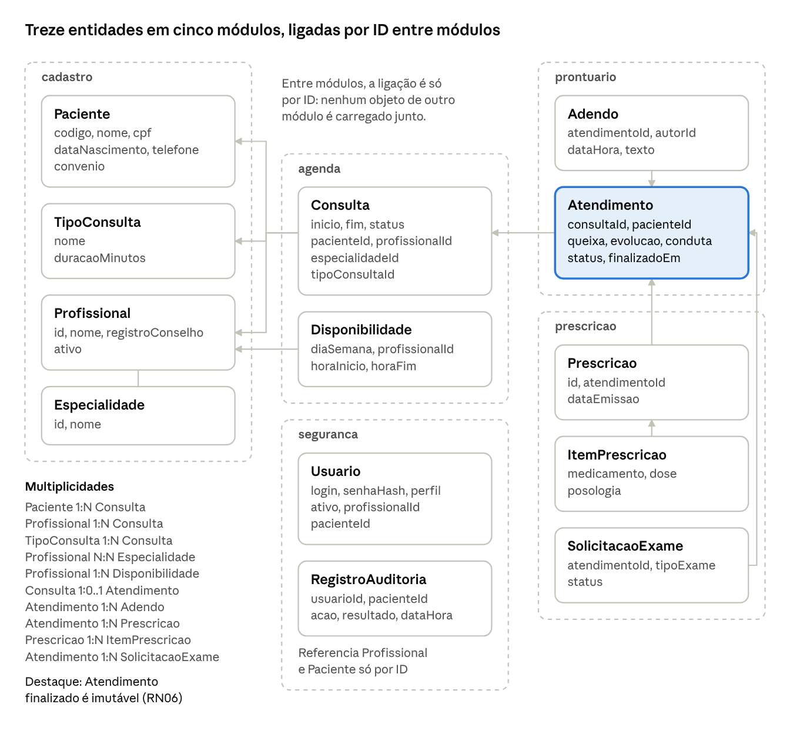

# SaúdeCerta — Arquitetura

## Entrega 2: Projeto arquitetural

IFPA · TEADS0347 – Desenvolvimento de Aplicações Multicamadas · Turma NOITE C795NL · 2026.2 · Docente: Márcio Goes do Nascimento


---

## 1. Drivers e cenários de qualidade

Ordem de prioridade dos drivers (E1): 1) evolução e modificabilidade, 2) simplicidade e manutenção, 3) desempenho e disponibilidade; segurança e LGPD entram como restrição obrigatória.

| ID | Atributo | Situação | O sistema deve | Meta |
|---|---|---|---|---|
| RNF01 | Modificabilidade | A equipe inclui o módulo de faturamento (futuro) | Aceitar o módulo novo sem mudar agenda e prontuário | Até 5 dias; nenhuma alteração no domínio de agenda e prontuário |
| RNF02 | Manutenibilidade | Um novo integrante clona o repositório | Subir localmente com H2 e dados de exemplo | Até 30 min seguindo o README |
| RNF03 | Segurança | Recepcionista, profissional sem vínculo ou paciente tenta abrir um prontuário que não pode | Responder 403 sem conteúdo clínico e auditar como `NEGADO` | 100% das tentativas indevidas bloqueadas |
| RNF04 | Auditabilidade | Alguém abre um prontuário | Registrar usuário, paciente, data/hora, ação e resultado | Visível ao `ADMIN` em até 1 min |
| RNF05 | Desempenho | Recepcionista busca paciente por nome; profissional abre prontuário | Responder paginado e com índices, com 20 profissionais, 10 mil pacientes e 50 mil consultas | p95 abaixo de 2 s |
| RNF06 | Disponibilidade | Falha do processo no horário de funcionamento (12 h/dia) | Reiniciar sozinho, expor healthcheck (Spring Actuator), usar transações curtas e timeouts | 99% ou mais por mês no horário. Falha de hardware: recuperação manual |
| RNF07 | Usabilidade | Recepcionista marca uma consulta | Oferecer fluxo curto, com aviso imediato de horário ocupado | Até 1 min e 5 cliques a partir da tela inicial |
| RNF08 | Credenciais | Revisor inspeciona código e banco | Guardar senhas só com BCrypt, nunca em log | Zero senhas em texto |
| RNF09 | Recuperabilidade | Perda do disco do servidor | Restaurar o banco a partir do backup diário em outro dispositivo | Perda máxima de 24 h; restauração testada todo mês |

---

## 2. Diagramas C4

### 2.1 Nível 1: Contexto



| Elemento | Tipo | Descrição |
|---|---|---|
| Recepcionista (`RECEPCAO`) | Pessoa | Cadastra pacientes, marca, remarca e cancela consultas. Sem acesso clínico. |
| Profissional de saúde (`PROFISSIONAL`) | Pessoa | Registra atendimentos, adendos, prescrições e exames dos pacientes com os quais tem vínculo. |
| Paciente (`PACIENTE`) | Pessoa | Consulta os próprios dados, agendamentos e prontuário, somente leitura. |
| Administrador (`ADMIN`) | Pessoa | Gerencia usuários, disponibilidade e especialidades; consulta auditoria e relatórios; lê prontuários. |
| SaúdeCerta | Sistema | Gestão de cadastros, agenda, prontuário, prescrições e exames, relatórios, segurança e auditoria. |
| Faturamento e convênios, laboratórios, lembretes | Sistemas externos (futuros, fora do escopo) | Pontos de extensão; não existem na v1. |

Os quatro perfis usam o sistema dentro da clínica, e os sistemas externos aparecem tracejados por serem extensões futuras.

### 2.2 Nível 2: Contêineres



| Contêiner | Tecnologia | Responsabilidade | Comunicação |
|---|---|---|---|
| Aplicação web (SPA) | React + TypeScript (Vite), no navegador | Telas e experiência de uso; sem regra de negócio | HTTPS + JSON (REST) com a API |
| API SaúdeCerta | Java 17, Spring Boot 3 (monólito modular) | Casos de uso, regras, segurança, auditoria e relatórios | JDBC com o banco |
| Banco de dados | PostgreSQL (H2 em desenvolvimento), um schema por módulo | Cadastros, agenda, prontuário, prescrições, exames e auditoria | Acessado só pela API |
| Rotina de backup | Script agendado (`pg_dump`) | Backup diário copiado para outro dispositivo, com retenção de 30 dias | Lê o banco; grava no dispositivo externo |

**Implantação:** servidor único na clínica, com API e banco em processos separados. O banco escuta só em localhost e o cliente nunca o acessa direto. O tráfego usa HTTPS. O navegador só conversa com a API; o backup é a única saída de dados para outro dispositivo.

### 2.3 Nível 3: Componentes da API



| Módulo | Componentes principais | Depende de |
|---|---|---|
| cadastro | `PacienteController` e `PacienteService`; `ProfissionalService`, `EspecialidadeService`, `TipoConsultaService`; `Paciente`, `Profissional` e portas de repositório | shared |
| agenda | `ConsultaController`, `DisponibilidadeController`, `AgendaService`, `Consulta`, `ConflitoHorarioPolicy`, `CalculadoraHorariosLivres`, `ConsultasDoProfissionalQuery`, `ConsultasAgregadasQuery` | cadastro (via serviço), shared |
| prontuario | `ProntuarioController`, `AtendimentoService`, `HistoricoService`, `Atendimento`, `Adendo`, `VinculoProfissionalPacientePolicy`, publicador do evento `ProntuarioAcessado`, `AtendimentoQuery` | agenda (via `ConsultasDoProfissionalQuery`), cadastro, shared |
| prescricao | `PrescricaoController`, `ExameController`, `PrescricaoService`, `ExameService`, `Prescricao`, `ItemPrescricao`, `SolicitacaoExame` | prontuario (via `AtendimentoQuery`), shared |
| relatorios | `RelatorioController`, `RelatorioService` | agenda (via `ConsultasAgregadasQuery`), cadastro (nomes), shared |
| seguranca | `SecurityConfig` (sessão, BCrypt, CSRF), `UsuarioService`, regras RBAC, `AuditoriaListener` (assíncrono), `AuditoriaService`, `AuditoriaController` (só `ADMIN`) | shared (eventos) |
| shared | Exceções, `@ControllerAdvice`, eventos de domínio, configuração, utilitários | nenhum |

**Regras de dependência:**

1. Módulos só se falam por serviços de aplicação, interfaces de consulta (Query) ou eventos, nunca por tabelas ou repositórios do outro.
2. Referências entre módulos são por ID.
3. Não há dependência cíclica.

A verificação é feita em revisão de código, como previsto na E1. O único acoplamento entre prontuário e segurança é o evento; as demais dependências seguem uma única direção, sem ciclos.

**Fluxo "abrir prontuário":** o controller recebe a requisição → o perfil é checado → o `HistoricoService` verifica o vínculo (RN10) ou a propriedade (RN12) → carrega atendimentos, adendos, prescrições e exames → publica `ProntuarioAcessado` → o `AuditoriaListener` grava o registro de forma assíncrona → resposta. Se o acesso for negado, o mesmo evento é publicado com resultado `NEGADO` e a resposta é 403.

---

## 3. Camadas e componentes

| Camada | Responsabilidade | Exemplo (módulo agenda) | O que não pode fazer |
|---|---|---|---|
| Apresentação (`api`) | Receber HTTP, validar entrada, converter para DTO | `ConsultaController`, `MarcarConsultaRequest` | Conter regra de negócio |
| Aplicação (`application`) | Orquestrar caso de uso, transação e chamadas a outros módulos | `AgendaService.marcar()` | Conhecer HTTP ou JPA |
| Domínio (`domain`) | Entidades, invariantes, políticas, portas | `Consulta`, `ConflitoHorarioPolicy`, `ConsultaRepository` (interface) | Conhecer Spring, JPA ou HTTP |
| Persistência (`infra`) | Implementar as portas | `ConsultaEntity`, `ConsultaMapper`, `ConsultaRepositoryAdapter` | Conter regra de negócio |
| Transversal | Segurança, auditoria, erros | `SecurityConfig`, `AuditoriaListener`, `@ControllerAdvice` | Depender de módulos de negócio |

### Estrutura de pacotes (igual em todos os módulos, RNF02)

```
br.edu.ifpa.saudecerta
├── cadastro     (api, application, domain, infra)
├── agenda       (api, application, domain, infra)
├── prontuario   (api, application, domain, infra)
├── prescricao   (api, application, domain, infra)
├── relatorios   (api, application)
├── seguranca    (usuarios, perfis, auditoria)
└── shared       (config, excecoes, eventos, util)
```

### Exemplo de porta definida no domínio e implementada na infra

```java
// agenda/domain
public interface ConsultaRepository {
    Consulta salvar(Consulta c);
    Optional<Consulta> buscarPorId(Long id);
    List<Consulta> agendadasDoProfissionalNoPeriodo(Long profissionalId,
                                                    LocalDateTime ini, LocalDateTime fim);
}
// agenda/infra: ConsultaRepositoryAdapter implements ConsultaRepository
// (Spring Data JPA + mapper manual)
```

### Onde cada regra é aplicada

| Regra | Camada e componente |
|---|---|
| RN01, RN09 | Domínio (`Paciente`); Bean Validation na api; alerta de duplicidade no `PacienteService` |
| RN02 | Domínio: `ConflitoHorarioPolicy`, acionada pelo `AgendaService` com bloqueio (ADR-004) |
| RN03 | Domínio: `Consulta` calcula o fim a partir de `TipoConsulta` |
| RN04 | Domínio: `Consulta.podeSerAtendida(hoje)` |
| RN05 | Domínio: `Consulta.remarcar()` e `cancelar()`, com antecedência parametrizável |
| RN06 | Domínio: `Atendimento.finalizar()` e `adicionarAdendo()`; sem setters e sem delete nos repositórios de prontuário e prescrição |
| RN07, RN10, RN12 | Perfil na api (`@PreAuthorize`); vínculo e propriedade na aplicação (`VinculoProfissionalPacientePolicy`) |
| RN08 | Transversal: evento e `AuditoriaListener` (ADR-002) |
| RN11 | Domínio: `Prescricao` e `SolicitacaoExame` só são criadas a partir de um `Atendimento` em andamento |

---

## 4. Modelo de domínio



| Entidade | Atributos principais | Relacionamentos |
|---|---|---|
| Paciente | `codigo` (imutável), nome, cpf, dataNascimento, telefone, convenio | 1 Paciente → N Consultas |
| Profissional | id, nome, registroConselho, ativo | N ↔ N Especialidade; 1 → N Disponibilidades |
| Especialidade | id, nome | N ↔ N Profissional |
| Disponibilidade | id, diaSemana, horaInicio, horaFim, profissionalId | N → 1 Profissional |
| TipoConsulta | id, nome, duracaoMinutos | 1 → N Consultas |
| Consulta | id, dataHoraInicio, dataHoraFim, status (`AGENDADA`, `REALIZADA`, `CANCELADA`), pacienteId, profissionalId, especialidadeId, tipoConsultaId | 1 → 0..1 Atendimento |
| Atendimento | id, consultaId, pacienteId, queixa, evolucao, conduta, status (`EM_ANDAMENTO`, `FINALIZADO`), finalizadoEm | 1 → N Adendos, Prescrições e Solicitações de exame |
| Adendo | id, atendimentoId, autorId, dataHora, texto | N → 1 Atendimento |
| Prescricao | id, atendimentoId, dataEmissao | 1 → N ItensDePrescricao |
| ItemPrescricao | id, medicamento, dose, posologia | N → 1 Prescricao |
| SolicitacaoExame | id, atendimentoId, tipoExame, status (`SOLICITADO`, `REALIZADO`) | N → 1 Atendimento |
| Usuario | id, login, senhaHash, perfil, ativo, profissionalId ou pacienteId (opcional) | 0..1 → Profissional ou Paciente |
| RegistroAuditoria | id, usuarioId, pacienteId, acao (`LEITURA`, `ALTERACAO`), resultado (`PERMITIDO`, `NEGADO`), dataHora | referencia usuário e paciente por ID |

As setas do diagrama indicam quem guarda a referência ao outro. O `Atendimento` (destacado) é o agregado central do prontuário: prescrições, exames e adendos apontam para ele.

### Observações de modelagem

- **Agregados:** Paciente; Profissional (com Disponibilidades); Consulta; Atendimento (com Adendos); Prescricao (com itens); SolicitacaoExame; Usuario; RegistroAuditoria. Entre agregados e módulos a ligação é só por ID.
- **Prontuário** é um conceito, não uma tabela: é o conjunto de Atendimentos, Adendos, Prescrições e Solicitações de exame de um paciente, lido em ordem cronológica pelo `HistoricoService`.
- **Especialidade na Consulta:** a consulta guarda a especialidade sob a qual foi marcada, o que permite o relatório por especialidade (RF16) dentro do módulo de agenda, sem juntar tabelas de outro módulo.
- **Convênio** é um atributo do Paciente, com "Particular" como valor válido.
- **Invariantes:** Atendimento `FINALIZADO` é imutável; Adendo, Prescricao e ItemPrescricao nunca são alterados nem apagados; Consulta `CANCELADA` ou `REALIZADA` não volta a `AGENDADA`; o CPF é validado, mas não é chave (RN01).
- **Índices:** `paciente(nome)`, `paciente(codigo)`, `consulta(profissionalId, dataHoraInicio)`, `consulta(dataHoraInicio)`, `atendimento(pacienteId, finalizadoEm)`, `auditoria(pacienteId, dataHora)`.

---

## 5. Contrato da API (principais endpoints)

| Método | Rota | Perfis | Requisito |
|---|---|---|---|
| POST | `/api/pacientes` | `RECEPCAO`, `ADMIN` | RF01 |
| GET | `/api/pacientes?nome=` | `RECEPCAO`, `ADMIN`, `PROFISSIONAL` | RF01, RNF05 |
| GET | `/api/profissionais/{id}/agenda?data=` | `RECEPCAO`, `ADMIN`, `PROFISSIONAL` | RF04 |
| POST | `/api/consultas` | `RECEPCAO`, `ADMIN` | RF05, RF07 (409 em conflito) |
| PATCH | `/api/consultas/{id}` | `RECEPCAO`, `ADMIN` | RF06 |
| POST | `/api/consultas/{id}/atendimento` | `PROFISSIONAL` | RF08 |
| POST | `/api/atendimentos/{id}/finalizar` | `PROFISSIONAL` | RF08 |
| POST | `/api/atendimentos/{id}/adendos` | `PROFISSIONAL` | RF09 |
| POST | `/api/atendimentos/{id}/prescricoes` | `PROFISSIONAL` | RF14 |
| POST | `/api/atendimentos/{id}/exames` | `PROFISSIONAL` | RF15 |
| GET | `/api/pacientes/{id}/prontuario` | `PROFISSIONAL` (vínculo), `ADMIN`, `PACIENTE` (próprio) | RF10, RF17, RF12 |
| GET | `/api/me/consultas` | `PACIENTE` | RF17 |
| GET | `/api/relatorios/consultas?de=&ate=&agrupar=` | `ADMIN` | RF16 |
| GET | `/api/auditoria?pacienteId=` | `ADMIN` | RF12 |
| POST | `/api/usuarios` | `ADMIN` | RF13 |

Erros padronizados pelo `@ControllerAdvice`: 400 (validação), 403 (sem permissão), 404 e 409 (conflito de horário).
